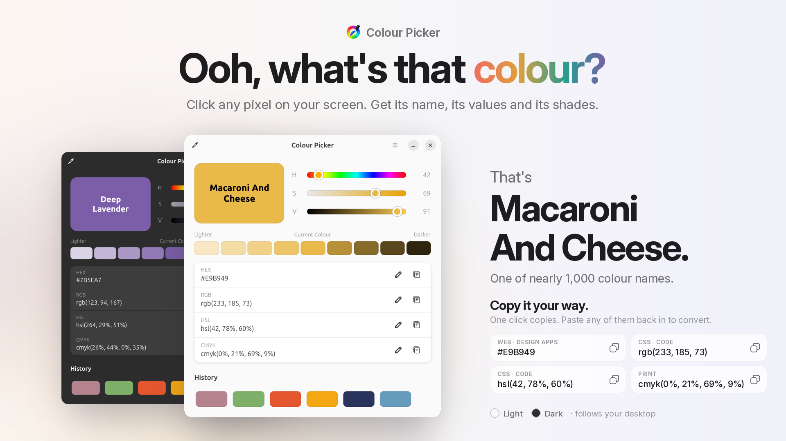

# Colour Picker: a color picker for Linux that names every colour

**Every colour has a name.** A small, native color picker (eyedropper) for GNOME on Linux, Wayland and X11. Click the eyedropper, click anything on your screen, and Colour Picker tells you what that colour is called, then lets you tune it and copy it as HEX, RGB, HSL or CMYK.

[](docs/ColourPicker_sizzle_v1.0.0.mp4)

*Click the image for the 36-second video.*

## What it does

- **Pick any pixel.** The eyedropper uses the desktop's screenshot portal, so you get the exact colour on screen, from any app.
- **See its name.** Nearly 1,000 names from the [xkcd colour survey](https://xkcd.com/color/rgb/) and the CSS named colours: Salmon, Deep Lavender, Moss Green, Macaroni And Cheese.
- **Named the way you see it.** The nearest name is found by perceived difference (CIE94 in the CIELAB colour space), not by raw RGB distance, so the name matches what your eye reports.
- **Tune it.** Hue, saturation and value sliders with live gradient tracks.
- **Lighter or darker.** A row of nine evenly stepped shades. Click one to use it.
- **Copy it your way.** One click copies the colour in the format you need: HEX (`#E9B949`) for the web and design apps, RGB (`rgb(233, 185, 73)`) or HSL (`hsl(42, 78%, 60%)`) for CSS and code, CMYK (`cmyk(0%, 21%, 69%, 9%)`) for print.
- **Paste to convert.** Paste or type a colour into any of the four fields and the others update, so it doubles as a quick colour converter.
- **History.** Your last 14 colours, one click away.
- **Light or dark.** Follows your desktop's style.

## Install

Download `colourpicker-1.0.0-x86_64-linux.tar.gz` from [Releases](../../releases), then:

```sh
tar xzf colourpicker-1.0.0-x86_64-linux.tar.gz
cd colourpicker-1.0.0
./install.sh
```

No sudo: the binary goes to `~/.local/bin` (or `PREFIX=~/Applications/ColourPicker ./install.sh`), plus a launcher and icon under `~/.local/share`. Remove it with `./install.sh --uninstall`.

Needs GTK 4.22 or newer and libadwaita 1.9 or newer (built and tested on Ubuntu 26.04), and `xdg-desktop-portal` (standard on GNOME) for screen picking.

## Build from source

Rust toolchain plus, on Ubuntu, `libgtk-4-dev libadwaita-1-dev libglib2.0-dev-bin pkg-config make`.

```sh
cd Code
cargo fetch --locked   # once, downloads the pinned crates
make                   # release build, copies the binary to bin/
make test              # colour maths tests
./install.sh           # optional
```

The crates are pinned to exact versions and `Cargo.lock` is committed; `make` builds offline from them.

## Files

- `Code/src/main.rs`: the window and screen picking
- `Code/src/colour.rs`: colour space conversions, parsers, nearest-name matching, tests
- `Code/src/xkcd_data.rs`: the colour name table

## Credits

Colour names: the [xkcd colour survey](https://xkcd.com/color/rgb/) (CC0) and the CSS Color Module named colours.

MIT licensed. Made by Droid.
